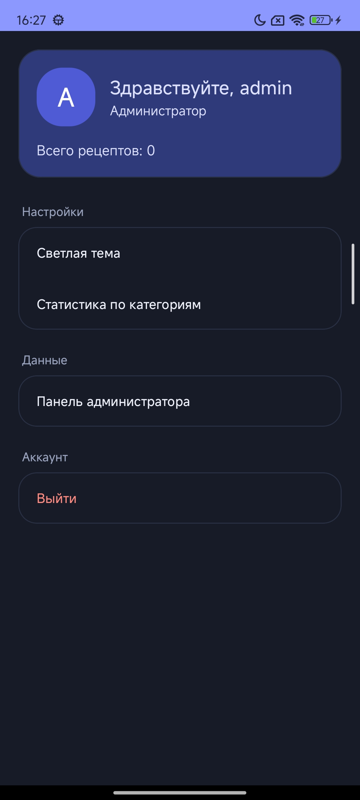
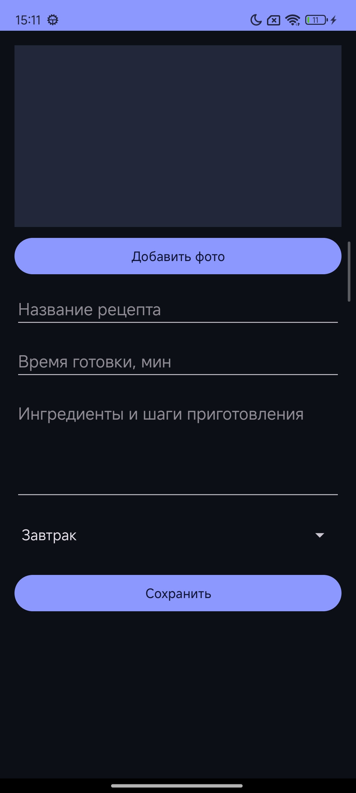

# RecipesApp

Android-приложение для рецептов и планирования питания. Индивидуальный проект по дисциплине «Мобильная разработка».

## Возможности

- Регистрация и авторизация пользователя
- Каталог рецептов с категориями
- Добавление, редактирование и удаление рецептов
- Поиск по рецептам
- План питания на неделю
- Статистика по категориям

## Технологии

- Kotlin, XML-разметка, ConstraintLayout, RecyclerView
- SQLite через SQLiteOpenHelper
- Корутины для фоновых запросов к БД

## Скриншоты

_Добавьте скриншоты экранов после их готовности._

## Скриншоты

## Скриншоты

| Вход | Список рецептов |
|---|---|
|  |  |

| Детали рецепта | Профиль |
|---|---|
|  |  |

| Добавление рецепта |
|---|
|  |