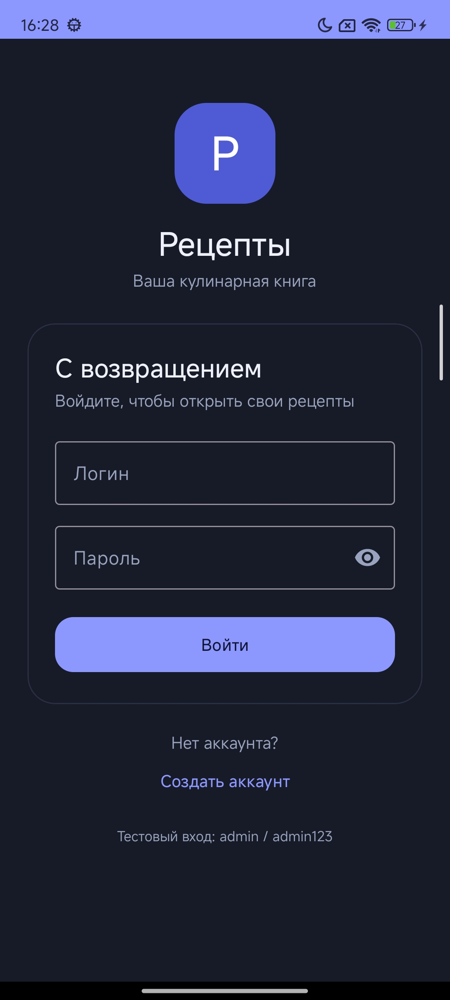
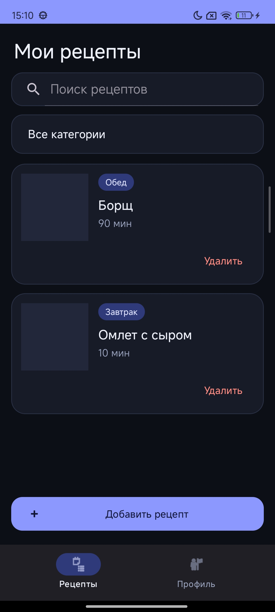
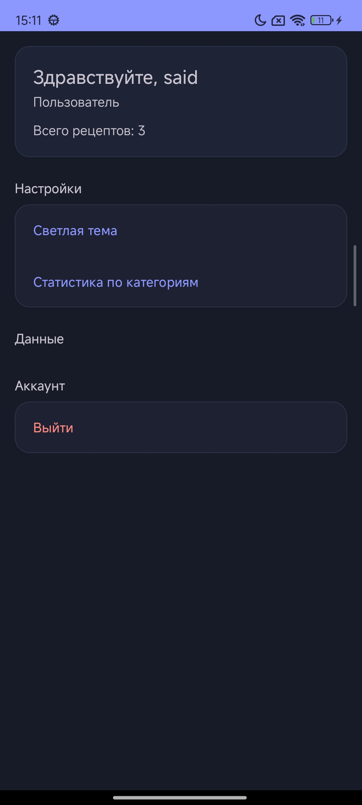

# RecipesApp

Android-приложение для рецептов. Индивидуальный проект по дисциплине «Мобильная разработка».

## Возможности

- Регистрация и авторизация пользователя
- Каталог рецептов с категориями
- Добавление, редактирование и удаление рецептов
- Фото блюд (выбор из галереи)
- Поиск по рецептам
- Фильтр по категории
- Статистика по категориям
- Профиль, переключение светлой и тёмной темы
- Панель администратора: смена ролей и удаление пользователей

## Технологии

- Kotlin, XML-разметка, ConstraintLayout, RecyclerView, Material 3
- SQLite через SQLiteOpenHelper
- SharedPreferences для сессии и темы
- Фоновые операции через Thread и runOnUiThread

## Скриншоты

| Вход | Список рецептов |
|---|---|
|  |  |

| Детали рецепта | Профиль |
|---|---|
|  |  |

| Добавление рецепта |
|---|
|  |

## Документация

- [Анализ](doc/analysis.md)
- [Руководство пользователя](doc/user-guide.md)
- [Руководство администратора](doc/admin-guide.md)
- [План тестирования](doc/test-plan.md)